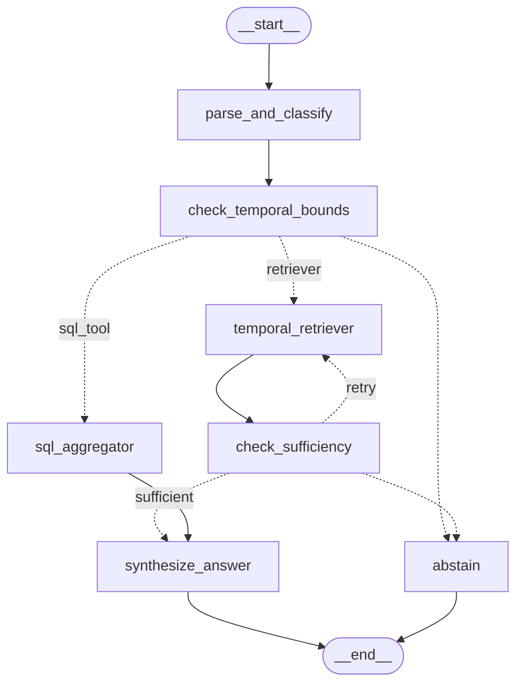

# Arquitetura

> Projeto de aprendizado com dados sintéticos e sem LLM. Este documento descreve o que o código faz hoje; o que ficou de fora está em [`APRENDIZADOS_E_LIMITACOES.md`](APRENDIZADOS_E_LIMITACOES.md).

## 1. Modelo bitemporal

Cada evento da linha do tempo de um cliente (`TimelineEvent`, em `models/schema.py`) carrega duas dimensões de tempo:

| Campo | Pergunta que responde |
| :--- | :--- |
| `valid_from`, `valid_to` | Em que período o fato foi verdadeiro **no mundo real**? (`valid_to = None` significa "até ser substituído") |
| `recorded_at` | Quando o CRM **registrou** o fato? |

Exemplo: o cliente mudou para o plano Pro em 10/03/2023, mas o CRM só registrou isso em 14/03/2023. Se alguém pergunta em 12/03/2023 qual era o plano (do ponto de vista do que o sistema sabia), o evento ainda não existe para o sistema. Por isso o retriever aplica duas regras: o evento precisa ser **válido na data** (`is_valid_as_of`) e **já registrado** (`was_recorded_by`).

Tipos de evento: troca de plano, ticket, e-mail, ligação, fatura, NPS, nota e atualização cadastral (`EventType`). O gerador sintético cria troca de plano, tickets (abertura e resolução), faturas mensais, NPS, atualização cadastral, nota de criação e, em cerca de 15% dos clientes, um e-mail com texto adversarial (por exemplo "ignore todas as instruções"). Ligações existem no esquema, mas o gerador não as cria.

## 2. Persistência

`storage/db.py` usa SQLAlchemy 2 com duas tabelas (`customers` e `timeline_events`) e índices em `valid_from`, `valid_to`, `recorded_at` e um índice composto `(customer_id, valid_from, valid_to)`. O padrão é SQLite em `data/crm_temporal.db`. Definindo `DATABASE_URL`, o mesmo código aponta para PostgreSQL, **caminho que não foi testado**. O `docker-compose.yml` sobe uma imagem Postgres 16 com pgvector, mas o código não cria colunas vetoriais nem usa a extensão.

## 3. Fluxo de uma pergunta

```
pergunta + customer_id
        │
        ▼
  extrator de intenção  ──►  categoria, datas, plano, ticket, flag "unsafe"
        │
        ▼
  grafo do agente (LangGraph)  ──►  resposta + eventos citados + trilha de raciocínio
```

### 3.1 Grafo do agente

O diagrama abaixo foi gerado pelo próprio código (`get_graph_mermaid()`).



| Nó | O que faz | Observação honesta |
| :--- | :--- | :--- |
| `parse_and_classify` | Chama o extrator de intenção; usa a categoria e a data do chamador se vierem, senão as inferidas | No modo cego do benchmark, nada vem do chamador |
| `check_temporal_bounds` | Bloqueia pedidos inseguros; abstém-se se o cliente não existe ou se a data é anterior à criação da conta; roteia (agregação vs. recuperação) | A guarda de segurança roda antes de qualquer recuperação |
| `sql_aggregator` | Conta faturas ou chamados numa janela de datas | O nome sugere SQL, mas é um filtro em Python sobre os eventos do cliente |
| `temporal_retriever` | Ramos por categoria: mudança de plano, ordenação por data, contradição (endereço), multi-hop (dois eventos encadeados), estado numa data | Boa parte é lógica determinística, não busca por similaridade |
| `check_sufficiency` | Se não houve evidência, tenta uma segunda vez (`retry`); persistindo a falha, abstém-se | O "loop de reflexão" tem no máximo uma repetição |
| `synthesize_answer` | Monta a resposta com modelos de texto e cita os IDs dos eventos usados | Sem LLM; não há verificação de fundamentação além do uso dos eventos recuperados |
| `abstain` | Devolve "ABSTAIN" ou a mensagem de bloqueio | |

Multi-hop significa encadear dois eventos: (a) a partir de um ticket, achar a data de abertura e depois o plano vigente nessa data; (b) a partir de uma troca de plano, achar a primeira fatura posterior.

### 3.2 Extrator de intenção (`agent/intent.py`)

Interface `IntentExtractor.extract(query) -> ParsedIntent` com dois modos:

- **`RuleBasedExtractor` (padrão):** regras e expressões regulares em `temporal_parser.py` (datas em `dd/mm/aaaa`, ISO e por extenso; palavras-chave de intenção).
- **`LLMIntentExtractor`:** recebe uma função `complete(prompt) -> str` fornecida por quem usa. O prompt trata a pergunta como dado; a resposta precisa ser um JSON válido (categoria, datas ISO, plano, ticket, `unsafe`). Qualquer saída inválida faz o extrator cair nas regras e contar um `fallback`. Nenhum provedor vem embutido e nenhuma chamada de API acontece por padrão. Os testes usam um dublê com respostas fixas.

### 3.3 Recuperação

Há dois níveis:

1. **Dentro do agente:** `NaiveRetriever` (baseline, TF-IDF por similaridade, ignora o tempo) e `TemporalRetriever` (filtros bitemporais mais decaimento por recência).
2. **Na ablação** (`retrieval/strategies.py`): variantes comparáveis entre si, todas calculadas sobre o corpus inteiro de eventos.

| Variante | Como funciona |
| :--- | :--- |
| `tfidf` | TF-IDF (1–2 gramas, sublinear) e similaridade do cosseno |
| `bm25` | BM25 Okapi implementado no projeto (k1 = 1,5; b = 0,75) |
| `lsa` | TF-IDF reduzido por SVD (48 componentes); é um substituto simples para embeddings densos, **não** uma rede neural |
| `hybrid` | Fusão de BM25 e LSA por Reciprocal Rank Fusion (k = 60) |
| `+ filtro temporal` | Descarta eventos fora da validade/registro na data da pergunta, ou fora da janela de duas datas; o filtro é derivado só do texto da pergunta |
| `+ decaimento` | `0,7·score normalizado + 0,3·exp(−λ·dias)`, λ = 0,005 |

## 4. Decisões de design e trade-offs

| Decisão | Motivo | Custo |
| :--- | :--- | :--- |
| Dados sintéticos com seed fixa | Gabarito exato e resultados reproduzíveis | Os dados e o benchmark compartilham o mesmo gerador; não há ruído real |
| Respostas por modelos de texto, sem LLM | Custo zero e determinismo para estudar a recuperação e o roteamento | Não mede qualidade de geração nem alucinação |
| Extrator por regras como padrão | Barato e testável | Frágil a redações novas (ver `AVALIACAO.md`) |
| SQLite como padrão | Rodar sem Docker | O caminho Postgres/pgvector ficou como exercício futuro |
| Ablação separada do agente | Isolar o efeito de cada técnica de recuperação | O agente não usa as variantes híbridas da ablação |
| Dependências mínimas (scikit-learn, numpy) | Evitar baixar modelos | LSA no lugar de embeddings neurais |

## 5. Pontos de extensão

- Passar um extrator de LLM ao agente: `TemporalAgent(db, extractor=LLMIntentExtractor(minha_funcao))`.
- Apontar `TEMPORAL_RAG_LLM=modulo:funcao` e usar `--extractor llm` nos comandos `eval` e `eval-paraphrase`.
- Adicionar variantes à ablação em `DEFAULT_VARIANTS`.
